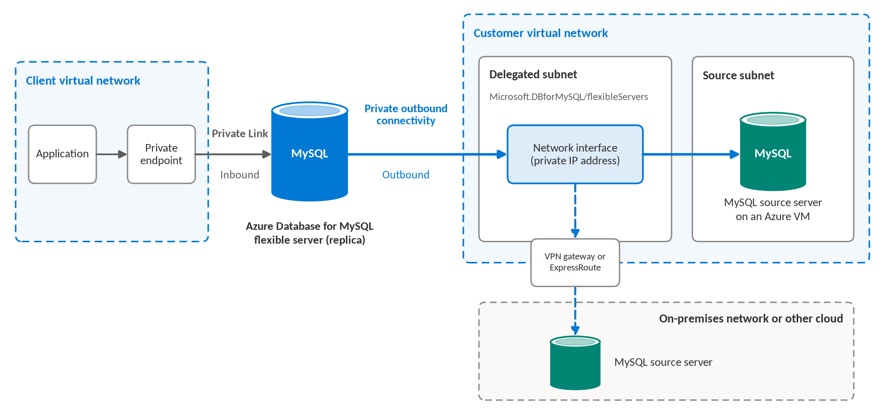
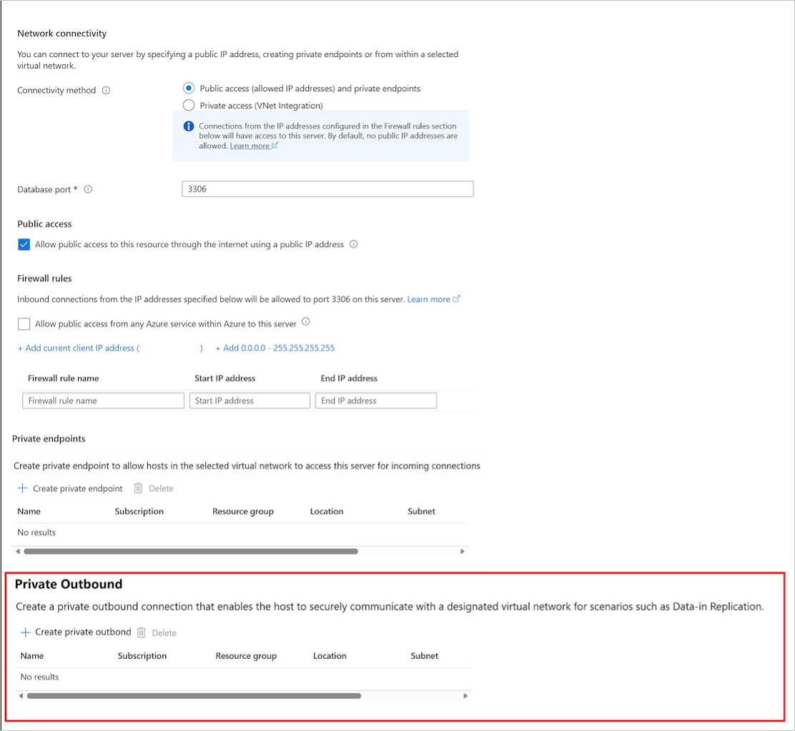
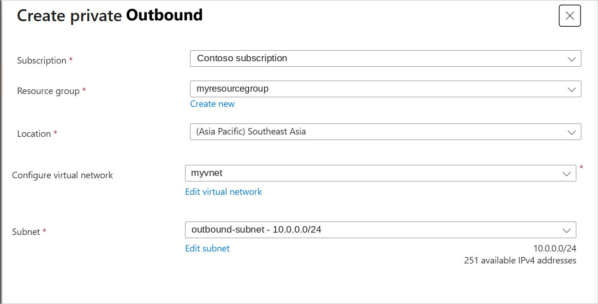
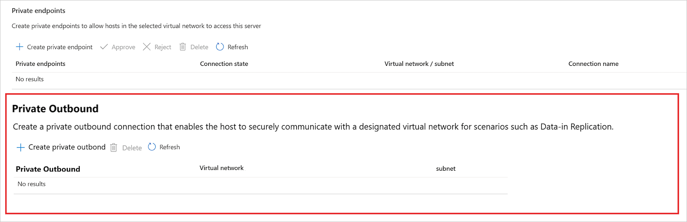

# Private outbound connectivity for Azure Database for MySQL flexible server (preview)

Private outbound connectivity gives your Azure Database for MySQL flexible server instance a private network path into a virtual network that you choose. Your server can then reach sources that aren't exposed to the internet, such as a data-in replication source on an Azure virtual machine (VM), in an on-premises datacenter, or in another cloud.

> [!IMPORTANT]
> Private outbound connectivity is in preview. To use it, contact your Microsoft account team to enable it for your subscription. Previews are provided without a service-level agreement and aren't recommended for production workloads. For more information, see [Supplemental Terms of Use for Microsoft Azure Previews](https://azure.microsoft.com/support/legal/preview-supplemental-terms/).

## About private outbound connectivity

[Private Link](https://learn.microsoft.com/azure/mysql/flexible-server/concepts-networking-private-link) brings client connections *into* your server, but it doesn't give your server a way *out*. Without private outbound connectivity, a server that uses public access and private endpoints replicates over the public network, so the source must be publicly reachable. With public access disabled, data-in replication isn't possible. Private outbound connectivity closes this gap.

### How it works

- You delegate a subnet in your virtual network to `Microsoft.DBforMySQL/flexibleServers`, and select it for your server.
- The service adds a network interface for your server to that subnet. The network interface gets a private IP address from the subnet.
- When your server connects to a data-in replication source by its private IP address, the traffic goes through that network interface and follows your network's routing: within the virtual network, to a peered virtual network, or through a VPN gateway or ExpressRoute to an on-premises network or another cloud.
- Inbound connectivity is configured separately and doesn't change.

| | Private Link | Private outbound connectivity |
| --- | --- | --- |
| **Direction** | Inbound to your server | Outbound from your server |
| **Added to your virtual network** | A private endpoint | A network interface in a delegated subnet |
| **Per server** | One or more | One |

### Use cases

- **Replicate from a private source**: Run data-in replication from MySQL on an Azure VM, on-premises, or in another cloud, without a public endpoint on the source.
- **Stay private end to end**: Disable public access, use private endpoints for your clients, and still replicate.
- **Migrate with minimal downtime**: Keep a new server in sync with a private source until you cut over.
- **Move off virtual network integration**: After you [move a server from private access to Private Link](https://learn.microsoft.com/azure/mysql/flexible-server/how-to-network-from-private-to-public), keep a private path to the sources in your virtual network.

### Requirements

- **Preview access**: Your subscription must be enabled for the preview. Contact your Microsoft account team.
- **Connectivity method**: **Public access (allowed IP addresses) and private endpoints**, with public access enabled or disabled. Servers that use **Private access (VNet Integration)** aren't supported.
- **Compute size**: A size that supports at least three network interfaces, which means 8 or more vCores. The Burstable tier isn't supported.
  <!-- REVIEW: Confirm whether any Burstable compute sizes are supported. -->
- **Delegated subnet**: A dedicated subnet that's delegated to `Microsoft.DBforMySQL/flexibleServers`, in the same region as the server, with enough free IP addresses.
  <!-- REVIEW: Confirm the region requirement, how many IP addresses each server uses (including high availability), and whether servers can share the subnet. -->
- **Network path**: Routing from the subnet to the source. Network security groups, routes, and firewalls must allow TCP traffic from the subnet to the source's MySQL port (3306 by default).
- **Permissions**: Permission to join the subnet, for example through the [Network Contributor](https://learn.microsoft.com/azure/role-based-access-control/built-in-roles/networking#network-contributor) role on the virtual network.

### Supported features and limitations

- Each server supports one private outbound connection.
- High availability, compute scaling, server restarts, and point-in-time restore are supported. After a failover, the new primary server keeps the connection. When you scale, the new compute size must also support three network interfaces.
- During the preview, the connection carries data-in replication traffic.
- Configure the connection in the Azure portal, or set the server's `privateOutboundSubnetResourceId` property through the REST API (API version `2025-12-30`). The Azure CLI, Azure PowerShell, and Terraform aren't supported yet.
- The preview isn't available in Azure Government or Azure operated by 21Vianet.
  <!-- REVIEW: Confirm the regions that are enabled for the preview. -->

## Configure private outbound connectivity in the Azure portal

Before you begin, make sure that you meet the [requirements](#requirements), and [delegate a subnet](https://learn.microsoft.com/azure/virtual-network/manage-subnet-delegation) to `Microsoft.DBforMySQL/flexibleServers`. The examples use the virtual network *myvnet* and the subnet *outbound-subnet*.

<!-- REVIEW: The screenshots in this section are placeholders made from design mockups. Recapture them from the live portal before publishing. -->

### For a new server

1. In the Azure portal, search for and select **Azure Database for MySQL flexible servers**, and then select **Create**.
1. On the **Basics** tab, under **Compute + storage**, select **Configure server**. Choose a compute size with 8 or more vCores, and then select **Save**.
1. On the **Networking** tab, for **Connectivity method**, select **Public access (allowed IP addresses) and private endpoints**.
1. Under **Private Outbound**, select **Create private outbound**.

   

1. In the **Create private outbound** pane, enter the following values, and then select **OK**.

   | Setting | Value |
   | --- | --- |
   | **Subscription** | The subscription that contains your virtual network |
   | **Resource group** | A resource group, such as *myresourcegroup* |
   | **Location** | The region of your server |
   | **Configure virtual network** | *myvnet* |
   | **Subnet** | *outbound-subnet* |

   

   <!-- REVIEW: Explain what the Resource group setting is used for, and confirm the name of the button that closes the pane. -->

1. Complete the other tabs, and then select **Review + create** > **Create**.

After deployment, the connection appears on the server's **Networking** page under **Private Outbound**.

### For an existing server

1. In the Azure portal, go to your server. Under **Settings**, select **Networking**.
1. Under **Private Outbound**, select **Create private outbound**.

   

1. In the **Create private outbound** pane, enter the [same values as for a new server](#for-a-new-server), and then select **OK**.

   <!-- REVIEW: Confirm whether you also need to select Save on the Networking page. -->

When the update completes, the connection appears under **Private Outbound** with its virtual network and subnet.

### Set up data-in replication

Follow [Configure data-in replication](https://learn.microsoft.com/azure/mysql/flexible-server/how-to-data-in-replication), with these changes:

- On the source server, allow connections from the address range of the delegated subnet. For example, create the replication user as `'syncuser'@'10.0.0.%'`, and allow the MySQL port in the source's firewall.
- When you link the servers, specify the source server's private IP address as the host.
- Use TLS for the replication connection.

## Related content

- [Private Link for Azure Database for MySQL flexible server](https://learn.microsoft.com/azure/mysql/flexible-server/concepts-networking-private-link)
- [Replicate data into Azure Database for MySQL flexible server](https://learn.microsoft.com/azure/mysql/flexible-server/concepts-data-in-replication)
- [Configure data-in replication](https://learn.microsoft.com/azure/mysql/flexible-server/how-to-data-in-replication)
- [Add or remove a subnet delegation](https://learn.microsoft.com/azure/virtual-network/manage-subnet-delegation)
